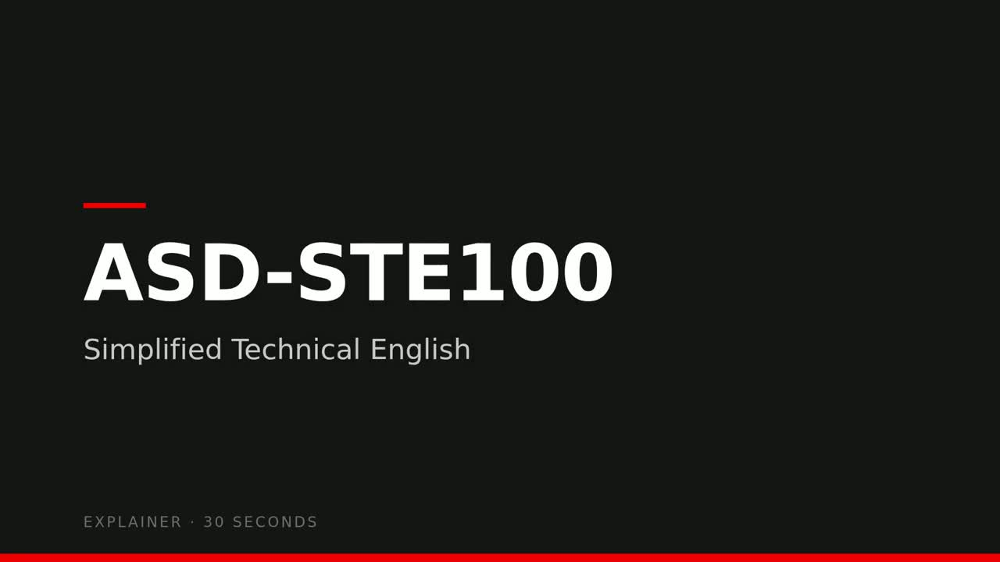

# asd-ste100-video

Home of the **`explainer-video`** skill: short, narrated explainer videos
from a simple scene script — Red Hat–styled 1920×1080 slides, Microsoft
neural TTS narration (edge-tts), assembled deterministically with ffmpeg.

## Demo

The pipeline's original output — a 32-second **ASD-STE100** explainer,
narrated by `en-US-JennyNeural @ +20%`:

[](https://eformat.github.io/asd-ste100-video/asd-ste100-explainer.html)

*32s · 1920×1080 · 1.1 MB — click the poster to play. Built by
`make_video.py` from [`explainer-video/examples/asd-ste100.json`](explainer-video/examples/asd-ste100.json),
no video editing anywhere.*

## Layout

```
explainer-video/               the skill (symlinked into ~/.agents/skills/)
├── SKILL.md                   agent-facing instructions
├── scripts/make_video.py      one deterministic build: script.json → mp4
├── scripts/narrate_recording.py   narration + slides over an existing recording
├── templates/slides.template.html   Red Hat dark/red slide theme
└── examples/asd-ste100.json   the original six-scene script
docs/                          demo video + poster (embedded in this README)
pyproject.toml, uv.lock        python deps (edge-tts ≥ 7.3.1 — pinned floor)
```

## Quickstart

```bash
# as a skill: just ask your agent for "an explainer video about X"

# or run the pipeline directly:
python3 explainer-video/scripts/make_video.py \
    explainer-video/examples/asd-ste100.json \
    --out ~/Videos/asd-ste100-explainer.mp4
```

Requirements (already present on the machine this was built on):
`edge-tts` (`~/.local/bin/edge-tts`), `google-chrome`, `ffmpeg` with
libopenh264 + aac, `ffprobe`.

## Install

Python side — the only pip dependency is `edge-tts`, and the floor matters:
7.2.8 403s on every synthesis call; **7.3.1 is clean**. `pyproject.toml` +
`uv.lock` pin exactly that.

```bash
# uv
uv sync                      # .venv with edge-tts 7.3.1; use `uv run` or
                             # activate .venv so the edge-tts CLI is on PATH

# or plain pip
python3 -m pip install --user "edge-tts>=7.3.1"
```

System side — shells out to these, checked at build time:

| tool | role | notes |
|---|---|---|
| `google-chrome` (or `chromium`) | renders the slide PNGs | any recent build |
| `ffmpeg` **with libopenh264** + aac | encodes the segments | Fedora builds have **no libx264** — the skill targets libopenh264 and falls back if `-rc_mode quality` is unsupported |
| `ffprobe` | measures narration, validates output | ships with ffmpeg |

## Pipeline

1. `edge-tts` narrates each scene; `ffprobe` measures it
2. auto-fit: if the total overshoots `target`, rate steps +5% up to a cap,
   then it's a script-trimming problem, not a speed problem
3. `google-chrome --headless` screenshots each filled slide template (1920×1080)
4. ffmpeg loops each PNG under its narration (+pad), concat,
   `libopenh264 -rc_mode quality` + `aac`
5. validates streams/duration and emits a frame-burst `sheet.jpg` for
   human/agent visual QA

No screen recording anywhere — stills + measured audio only, so builds
are deterministic and never drift.

## Git

Files created by the assistant; commits are made by the repo owner.
